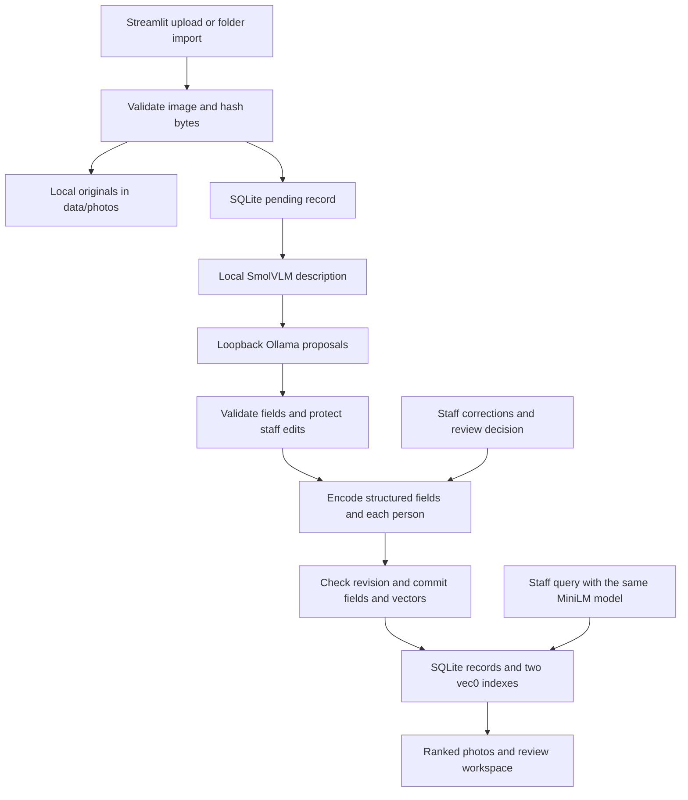

# SQLite photo discovery pipeline

Anthony maintains this independent implementation in `S0V3R31GN/AI-Photo-Discovery`.
The corrected v1.6 pitch supplies the functional contract. The old two-developer
execution plan does not describe ownership or branch strategy for this repository.

`db.py` owns paths, schema, registration, reads, validation, review saves, generated
saves, and failure status. `caption.py` owns lazy local inference and bounded batch
processing. `search.py` owns text assembly, cached embedding inference, vector
replacement, queries, and pivots. `app.py` consumes Python calls; it does not run SQL.
`data/photos.db` and originals are local and ignored by Git. JSON is not read during
normal app startup.

General vectors use only event/activity, location/setting, people, objects, and
user_input/staff notes. Caption and vision_description are never embedded. Each
participant description receives its own vector mapped to a photo ID. Confirmed
event and venue use exact SQLite equality and exclude the originating photo.
No caption-derived automatic group membership is created.

Inference and encoding finish before the write transaction. A revision comparison
rejects stale saves. The photo update, deletion of old vectors, insertion of
replacement vectors, and index bookkeeping commit together or roll back together.
Changed and explicitly submitted empty staff values are protected on regeneration.
The UI submits only changed fields. Accepted reviews do not automatically lock
all unchanged generated fields. Model failures preserve previous attributes and
vectors, mark the processing attempt failed, and expose a retry path.

The model ID, output dimension, and index schema version must match during reads
and writes. A rebuild encodes a complete snapshot first and swaps both indexes in
one transaction only if its photo/revision snapshot remains current.

## Verification boundary

Tests use real SQLite with sqlite-vec, synthetic PNGs, deterministic test vectors,
mocked vision/Ollama responses, and Streamlit AppTest. They verify transactional
behavior and UI integration, not model quality. Windows Python 3.14, HEIC decoding,
real SmolVLM/Ollama inference, and real-model end-to-end retrieval must be checked
on Anthony's machine. His prior successful MiniLM/sqlite-vec check is reported
local evidence, not a model test executed in this implementation environment.

Remaining submission work includes a real curated-image demo, timing measurements,
a structured sample exported through the approved process, and final challenge
submission materials. Do not present this code as a verified full submission.
